<!-- Paste this into README.md in the nnnnnoooooeeeee/nnnnnoooooeeeee repo -->

  <picture>
    <source media="(prefers-color-scheme: dark)" srcset="https://raw.githubusercontent.com/nnnnnoooooeeeee/nnnnnoooooeeeee/output/city-night.svg" />
    <source media="(prefers-color-scheme: light)" srcset="https://raw.githubusercontent.com/nnnnnoooooeeeee/nnnnnoooooeeeee/output/city-day.svg" />
    
  </picture>

