<!-- Paste into README.md in the nnnnnoooooeeeee/nnnnnoooooeeeee repo -->

<!-- Contribution pizza: 12 slices = 12 months, toppings = daily activity -->

  <picture>
    <source media="(prefers-color-scheme: dark)" srcset="https://raw.githubusercontent.com/nnnnnoooooeeeee/nnnnnoooooeeeee/output/pizza-dark.svg" />
    <source media="(prefers-color-scheme: light)" srcset="https://raw.githubusercontent.com/nnnnnoooooeeeee/nnnnnoooooeeeee/output/pizza-light.svg" />
    
  </picture>
   
  🧀 plain cheese = 0 · 🌿 basil = 1–2 · 🍄 mushroom = 3–5 · 🔴 pepperoni = 6–9 · 🌶️ spicy pepperoni = 10+ contributions

<!-- Optional: pixel city (same workflow already generates it) -->
<!--

  <picture>
    <source media="(prefers-color-scheme: dark)" srcset="https://raw.githubusercontent.com/nnnnnoooooeeeee/nnnnnoooooeeeee/output/city-night.svg" />
    
  </picture>

-->
